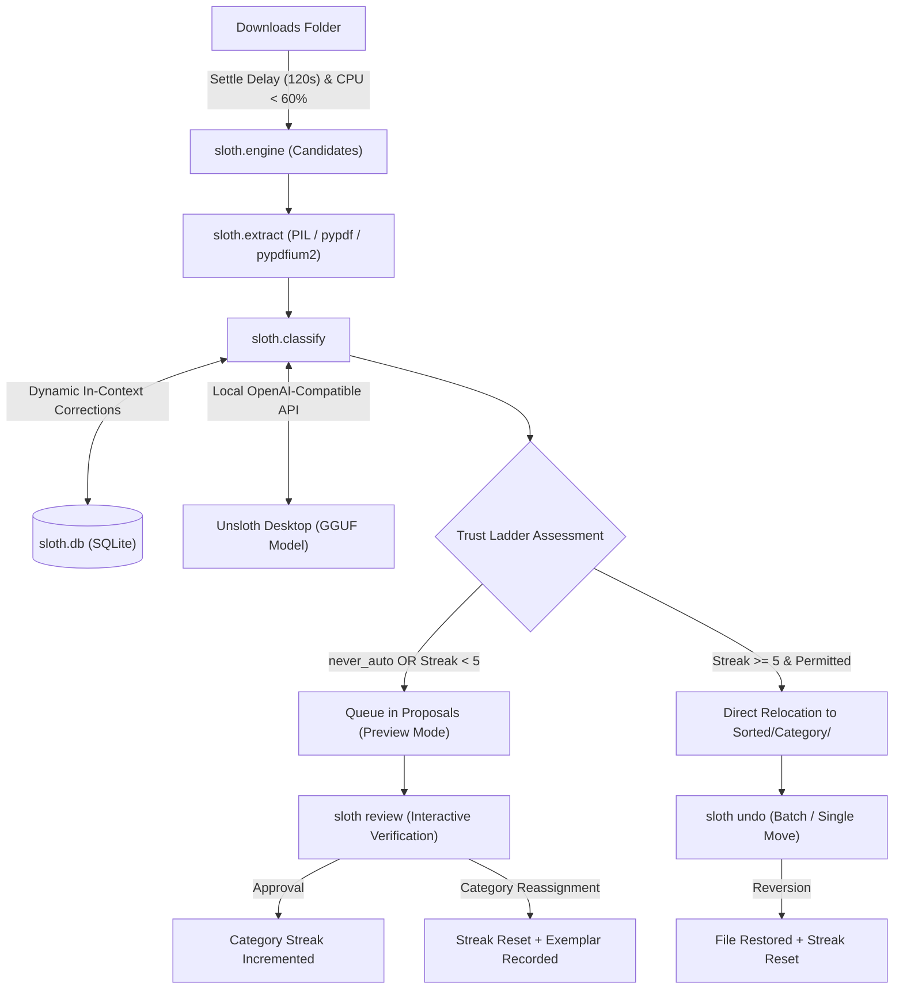

# Clutter Sloth

A slow, deliberate, local-only sorting system designed for the Downloads directory. Each file is analyzed by a small open-weight vision model served locally via **Unsloth Desktop**, assigned a descriptive title, and organized into an appropriate category folder. No data is transmitted externally, deletions are strictly prohibited, and all operations are fully reversible.



---

### Architectural Characteristics: Designed for Sloth-Like Restraint

- **Idle-Only Processing.** Files are required to remain undisturbed for `settle_seconds` (default: 120 s) prior to examination. Items are evaluated sequentially at below-normal process priority, and execution is permitted only while system CPU utilization remains below `cpu_ceiling` (default: 60%). Rest pauses are observed between consecutive file operations.
- **A Progressive Trust Ladder.** Initial operation for every category is conducted strictly in preview-only mode. Once `trust_threshold` consecutive approvals (default: 5) are recorded without error, autonomous relocation is enabled for that category. The trust streak is immediately reset back to preview-only mode whenever a correction is submitted or an undo operation is triggered.
- **Sensitive Document Safeguards (`never_auto`).** Identity credentials, financial records, and sensitive documents categorized under `never_auto` (default: `ID & Personal`) are permanently barred from autonomous relocation regardless of approval streak length. Manual review is invariably required prior to relocation.
- **Granular Categorization.** Out-of-the-box sorting is provided for: `ID & Personal`, `Tickets & Travel`, `Research Papers`, `Resumes`, `Invoices & Receipts`, `Documents`, `Screenshots`, `Images`, `Code & Data`, `Installers`, `Archives`, `Media`, and `Other`.
- **In-Context Correction Learning.** Adaptations are acquired from user corrections without requiring model fine-tuning. Recent corrections (e.g., *"`bill.pdf` belongs in Invoices & Receipts, not Documents"*) are dynamically injected as few-shot exemplars into subsequent classification prompts.
- **Total Reversibility.** Every relocation event is recorded in a local SQLite database. Batches are restored via `sloth undo`, and collision avoidance logic ensures that existing files occupying original locations are never overwritten.
- **Safety by Construction.** Top-level files alone are evaluated. Subdirectories, hidden files, and active download fragments (`.crdownload`, `.part`, `.tmp`) are skipped entirely. Destination naming collisions are resolved with numeric increments (` (2)`). Console I/O streams are automatically reconfigured for safe UTF-8 handling on Windows platforms.

---

## Installation & Setup

1. **Python 3.11 or greater** is required.
2. The package is installed in editable mode:
   ```bash
   pip install -e .
   sloth init
   ```
3. A **vision-capable GGUF model** (such as `Qwen3.5-4B-GGUF` with `mmproj`) is loaded in **Unsloth Desktop**, and the local API server is activated. On systems equipped with 4 GB VRAM (e.g. GTX 1650), 2–4B parameter models quantized to 4-bit (e.g. `Q4_K_M` or `IQ3_XXS`) are recommended. If a text-only model is preferred, `vision = false` may be specified in `config.toml` so that image files are sorted by filename heuristics alone.
4. Connection settings (`base_url`, `api_key`) are configured in `%USERPROFILE%\.clutter-sloth\config.toml` to match the endpoint displayed in Unsloth (e.g. `http://127.0.0.1:<port>/v1`).
5. Connection health is validated via:
   ```bash
   sloth doctor
   ```

---

## Command Reference

| Command | Operational Summary |
|---|---|
| `sloth scan --now` | A single pass across the directory is performed immediately, bypassing the settle timer. Elapsed processing time is reported. |
| `sloth review` | Pending proposals are presented for interactive approval (`Enter`), retention (`n`), or category reassignment (`c`). |
| `sloth run` | Background monitoring is initiated: incoming files are observed, settle delays are enforced, and proposals are generated at low process priority. |
| `sloth undo` | The most recent batch of relocations is reverted. Single relocations may be targeted via `--id N` (referenced from `sloth history`). |
| `sloth history` | A ledger of recent file movements and batch identifiers is displayed. |
| `sloth status` | Pending review counts, category streaks, and `never auto` restriction states are presented. |
| `sloth digest` | A markdown summary of automated vs. approved operations, undone moves, and category trust ladder tiers is compiled. |

Initial trials may be conducted safely on an isolated directory copy:
```bash
sloth --watch C:\path\to\a\copy scan --now
sloth --watch C:\path\to\a\copy review
```

Sorted files are deposited into `<watch_dir>\Sorted\<Category>\`. Files which cannot be inspected by the model (e.g. installers, archives, media binaries) are organized by extension rules and their original filenames are preserved.

---

## Hacktoberfest 2026: Week 3 Open-Source AI Challenge

This project is tailored for the **Hacktoberfest Open-Source AI Challenge: Week 3 ("Slow and Steady")**, organized in celebration of **International Sloth Day (October 20)**.

Empirical metrics for "The Lazy Payoff" are compiled via `sloth digest`:
- Files sorted: auto-moved vs. approved vs. corrected.
- Frequency of undone moves.
- Correction rate across reviewed items.
- Elapsed processing duration per scan batch.
- Progression of the trust ladder across individual categories.

Submissions are published on DEV with the required challenge tag: `#hf26challenge`.

---

## Automated Test Suite

The end-to-end test suite is executed using an integrated mock HTTP server, requiring no external GPU or model installation:
```bash
python tests/test_e2e.py
```

---

## License

This project is distributed under the terms of the [MIT License](LICENSE).
